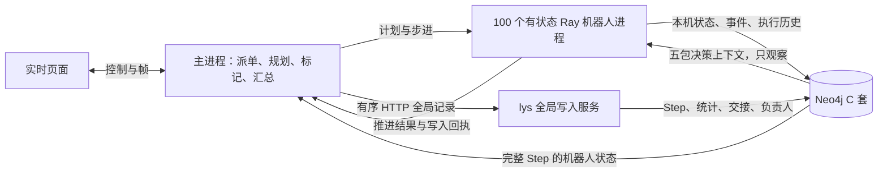

> 状态更新（2026-10-30）：下文保留旧同步配置的历史验收。生产已改为memory+有界异步；旧全天9264步失败，新全天尚未完成。最新结果见 [本轮总结](codex_notes/10/30-memory-async-graph.md)。

# 图谱驱动机器人仿真：实现与验收报告

日期：2026-10-30。分支：`wz/kg-driven-dispatch`。开发基线：`18bae53`；合并 lys 更新：`1f21f0b`（含 `cca56ac`、`de9424e`）。本分支不推送，由 wz 核对后决定合并。

本文区分代码实现、实际运行通过和未运行验收。研究原型的结果只作为背景，不计入本轮通过项；共享 4173 的部署状态也不由本分支代码状态推断。

## 1. 结论与范围

- 有状态 Ray actor、机器人完整状态逐步写入、Step 同步和图谱读取已接通。
- 只有机器人状态从图谱读取；任务、库存、货位、交通预约由主进程维护。
- 派单和交接的负责人变更由主进程提交，lys 的全局服务唯一维护 `Execution.current_robot_id`。
- 机器人上下文是观察链路，结果暂不参与派单；不实现 LLM。
- 当前已确认的完整真实基准是低电接力：1989 步逐条一致，最终完整 Step 与负责人检查通过。
- **正式 C 套联合验收通过**：同一业务 run 测量时超过 111 万节点，100 个独立 spawn 进程真实并发，持续 KG 写入；三轮各 10 秒平均 46.63、53.42、50.58ms，均小于 500ms，且每轮窗口内均观察到新 Step 提交。
- 最终回归 91 项为 89 通过、1 门控跳过、1 精确已知错误；真实 Ray 恢复另已通过（26.383 秒）。前端 42 项测试和 20 秒实际运动观察通过；冻结源码后的 400 步 KG/memory 检查点严格对照通过。全天最终 run 已启动，尚未完成。

## 2. 架构与实现对应

| 架构项 | 实现 | 证据或状态 |
|---|---|---|
| 主进程派单与全局标记 | `RobotProcessSplit` 调用原 V5 派单；标记按原机器人顺序处理 | 本地基准通过；交接需要时撤销重推 |
| 100 个有状态机器人进程 | `backend/robot_actor/local.py`、`ray_actor.py` | 一机器人一 Ray actor；不使用旧 AgentFleet 充当机器人推进 |
| 每步完整状态与回执 | `record_robot_current_state` 复用 lys writer；payload 为完整 19 字段 JSON，last_written_tick 精确 | 100 台写成功后才发布 Step；写失败最多重发 3 次，耗尽则暂停 |
| 图谱状态读取 | `backend/robot_actor/kg_state.py` | 等 `Run.latest_step >= t`，读 100 条 tick=t payload，原位替换字典；超时 2 秒报错 |
| 全局记录与负责人 | `GlobalRecordClient`、`global_writer.py`、`global_writer_api.py` | 有序 records 批最多 128 条；稳定 change_id；只有保存点带 dispatch；全局事实之后发布 Step |
| 途中接单 | V5 `task_chaining` | 主进程统一规划，actor 按顺序执行，不自主选择任务 |
| C 套上下文 | `RobotContextClient` 与 lys `warehouse_graph_query.py` | 五包：task_decision、energy_safety、request_help、provide_help、recovery；24 项接口/口径单测通过，真实 100 actor 查询结果另录 |
| 独立进程联合验收 | `ops/joint_acceptance.py` | 最终正式三轮资格与均值均通过；百万规模、100 独立进程、持续写入证据见第 5 节 |
| 旧路径退役 | 显式 `--legacy-a-graph`；弃用 `--robot-agents` | 默认关闭旧 A 套镜像；是否满足 C 套退役门槛单独看第 5 节 |
| 检查点恢复与全天 | 恢复重建 actor；`ops/kg_long_run.py` | 本地跨交接与真实 Ray 恢复通过；最终全天 run 已启动，尚无全天完成结果 |
| 页面 | 模式、最新完整 Step 差值、机器人写入错误 | 42 项前端测试通过；实际运动短窗验证见第 3 节 |

CLI 的兼容默认值为 `memory`；正式推荐命令显式选 `--kg-state-source neo4j`。`--ray` MotionActor 和 local 模式保留为对照。

## 3. 已执行测试与运行

| 验证项 | 实际结果 | 证据 |
|---|---|---|
| 最终相关回归 | 91 项：89 通过、1 门控 skip、1 已知精确 KeyError expected | `ops/kg_regression.py`；已知错误没有扩大为任意异常豁免，门控真实 Ray 另行运行通过 |
| 合并后快速测试 | 通过，约 5.8 秒 | `tests.test_robot_process_quick` |
| 最新快速与接口检查 | 37 项通过 | `/tmp/wz-kg-evidence/final-fast.log` |
| 本地 split、派单、live、client、runtime graph 回归 | 32 项中 31 项通过，1 项已知旧错误 | `/tmp/wz-kg-evidence/regression.log`；旧错误为 runtime graph 固定下标 `KeyError: 'robots'` |
| 真实低电接力基准 | 通过：全部派单、交接、完成时刻和结束步数一致 | `/tmp/wz-kg-evidence/relay.json`；1989 步，含 tick 0 共 1990 Step，每 Step 100 回执，owner=receiver=6，清理残留 0 |
| 真实撤销重推基准 | 本轮失败：第 891 步等待完整 Step 超时 | 发生于测试 Neo4j 堆内存耗尽期间；完整结果未验证，测试 run 最终 DELETE 残留已确认 0 |
| 真实普通派单基准 | 本轮未完成完整验证 | 三场景测试 fail-fast 后未继续；100 步有实际派单样本已通过，不代替完整基准 |
| 14590 指定边界 KG/memory 检查点对照 | 冻结源码后 400 步严格对照通过，checkpoint_equal=true | `/tmp/wz-kg-evidence/live-frozen/result.json`；KG 139.70 秒、memory 145.95 秒；请求速度 120，不计作 1 倍速全程或全天运行 |
| C 上下文接口与只读语义 | 24 项通过 | `tests.test_robot_context`、`tests.test_query_c_catalog`、`tests.test_warehouse_graph_query`，0.002 秒；覆盖最新完整 Step 与历史时间界限 |
| 检查点恢复继续等价 | 本地跨交接与真实 Ray 恢复通过 | `tests.test_robot_recovery`；真实 Ray 26.383 秒；`backend/wide/sim.py` 修复原位恢复遗留未来任务绑定 |
| A 套开关与 AgentFleet 弃用 | 开关接口小测试通过 | `tests.test_legacy_graph_switch`；默认 rules，required 需显式启用 legacy-a-graph |
| 前端状态与插值 | 42 项测试通过；实际运动短窗通过 | tick 235→263；20 秒 rAF P95 16.7ms、最大 33.3ms、超过 100ms 为 0、JS 错误 0；不外推全天或所有负载 |
| C 联合验收判定与兼容性 | 14 项单测通过；最终真实三轮 qualified=true、pass=true | `/tmp/wz-kg-evidence/joint-c-day-fullscale/`；以前的失败报告保留，未替换或冒充通过 |
| 测试 Neo4j 维护 | 已获授权并完成：17692 heap 上限 4 GiB | 维护前后 neo4j/system online，C Run 为 0、WHRun 为 19 且 ID 列表一致，3 个旧服务均未推进 |

真实服务测试通过环境变量显式启用；skip 不计真实通过。测试运行 ID 为 `wz-test-`，通过 DELETE API 删除并再查节点残留。初轮真实测试暴露了 lys 来源关系 Cypher 缺少 WITH 的错误，已修复并复验；修复前失败不算本轮通过项。

400 步检查点对照在同一份冻结源码上执行，源代码身份哈希未排除，参与严格比较。图谱最终 `latest_step=400`，含初始化 tick 0 共 401 个完整 Step，各有 100 回执；交接任务的 owner=receiver=6，两次运行的最终残留均为 0。归一化检查点 SHA256 为 `7f975b84692814580bd370dd1bb100b2a840ba5b9ae3391e3169b88a03393e76`。此前 1000 步尝试在源码中途变化后虽物理状态一致，但身份不一致，不计 strict 通过，由本次冻结源码的 400 步正式对照替代。

## 4. 五阶段性能

计时单位为毫秒/步。CPU 数是 Ray 的逻辑调度配额，不是 OS CPU 核绑定。actor CPU 份额为 0.02；Neo4j 为测试实例 17692。首步包含 actor 冷启动，均值排除首步。

| 场景 | CPU | 样本步数 | 推进 | 写入 | 等 Step | 读取 | 派单 | 总耗时 | 可达倍速 |
|---|---:|---:|---:|---:|---:|---:|---:|---:|---:|
| 启动阶段短样本 | 4 | 30 | 33.13 | 284.58 | 52.88 | 10.61 | 0.06 | 381.41 | 2.62 |
| 启动阶段短样本 | 16 | 50 | 41.30 | 178.20 | 35.19 | 12.51 | 0.08 | 267.42 | 3.74 |
| 启动阶段短样本 | 32 | 50 | 34.90 | 184.18 | 41.57 | 10.48 | 0.08 | 271.35 | 3.69 |
| 普通场景有实际派单 | 32 | 100 | 29.64 | 314.49 | 60.55 | 8.81 | 11.19 | 424.91 | 2.35 |
| 完整低电接力 | 32 | 1989 | 34.75 | 216.34 | 41.19 | 8.88 | 2.34 | 303.75 | 3.29 |

启动阶段短样本尚未进入同等任务负载，不能用它们断言忙时 4/16/32 的扩展效率。完整的相同窗口性能对照在获得结果后更新。写入耗时包含 actor 图谱写入与主进程提交开销，等 Step 反映全局服务异步落库屏障。

严格图谱逐步读取要求当前 Step 先可见，通常发送单条 records 批；客户端对积压记录支持合并至 128 条，并在重试中保持整批字节不变。不能为了凑批而推进到尚未确认的未来步。

## 5. 原始指标：C 套联合验收

当前结论：**正式最终验收 qualified=true、pass=true，满足原始指标。** 不把原型或旧 A 套查询成绩计入这里。

### 正式最终验收：持续 KG 生产者，三轮各 10 秒

生产者为最终全天 run `wz-test-day-20261030-final`，`producer_kg_state_source=neo4j`；100 个有状态 Ray actor 持续写 C 套，每 10 步另有 100 actor 后台查询。测量使用与机器人相同的 RobotContextClient，由 100 个独立 spawn 查询进程同步开始，三轮均有 100 个不同 PID、实际并发峰值 100。预热不计时，完整五包结果消费计入端到端耗时。

| 轮次 | 同 run 节点数 | 独立进程/并发峰值 | 请求数 | 平均 ms | P99 ms | 最大 ms | >500ms | 窗内观察到新 Step 提交 | 资格/结果 |
|---|---:|---|---:|---:|---:|---:|---:|---:|---|
| 1 | 1,113,057 | 100 / 100 | 21,478 | 46.6274 | 112.8603 | 208.3299 | 0 | 6 | 资格满足，通过 |
| 2 | 1,113,399 | 100 / 100 | 18,752 | 53.4248 | 88.6001 | 157.9191 | 0 | 21 | 资格满足，通过 |
| 3 | 1,114,757 | 100 / 100 | 19,803 | 50.5822 | 72.7879 | 151.9409 | 0 | 26 | 资格满足，通过 |

同时写入以测量窗口内两次完整读取之间实际观察到的新 Step 提交判定。边界前后 Step 变化 24/28/52 包含窗口外元数据阶段，不拿它代替表中的 6/21/26。每轮写入资格均为 true。

规模前缀是同一 run 下本次独占的 100 万条负 tick 合成 AgentState，用于历史规模，不冒充真实业务历史。测量结束后，仅清理本次前缀并验证残留 0；全天业务 run 继续写入，整 run 在全天结束后再通过 DELETE API 清理。

硬件：pro6000，152 逻辑 CPU、144 可用 CPU；写入 Ray 集群 32 CPU；Neo4j 17692、5.26.32、heap 上限 4 GiB。正式证据目录为 `/tmp/wz-kg-evidence/joint-c-day-fullscale/`，含 `acceptance.json`、`report.md`、三轮原始样本及 writer trace。此前所有失败报告保留。

### 初轮填数失败（保留证据）

目标负 tick 前缀是 100 万条。填充确认完成 300,000 条、尚未完成 400,000 条时，17692 返回 `Java heap space`；100 个查询 worker 尚未启动，实际查询数为 0，完成轮数为 0。因此没有本次百万级并发延迟分布，也不能判定平均耗时小于 500ms。

当时实例 Java heap 为 1 GiB，且还被 14193、14197 的已完成 run 及 14198 的暂停 run 连接。随后经 wz 明确授权，仅维护 17692 并将 heap 上限扩为 4 GiB。维护前后 neo4j/system 均 online，C Run 为 0、WHRun 为 19 且 ID 列表一致，3 个旧服务均未推进。已确认失败负 tick 前缀与受影响重推 run 的最终删除残留均为 0。首次失败报告保留在 `/tmp/wz-kg-evidence/joint-c/`。

合格条件是同一次运行实际节点数超过 100 万、100 个独立查询进程真实并发、每轮查询期间有持续写入、至少三轮成功。合格后按每轮 Agent 五包端到端平均耗时 `<500ms` 判定，另列 P99、最大值、超 500ms 次数、错误与实际工作进程数。

### 维护后第一次三轮（每轮 2 秒）

使用与 actor 相同的 RobotContextClient，100 个独立 spawn 进程同步开始。完整五包结果消费计入端到端时间，预热不计时。

| 轮次 | 同 run 节点数 | 独立进程/并发峰值 | 窗内生产 Step / 观察到新提交 | 平均 ms | P99 ms | 最大 ms | >500ms | 资格/结果 |
|---|---:|---|---|---:|---:|---:|---:|---|
| 1 | 1,022,476 | 100 / 100 | 3 / 3 | 73.71 | 304.20 | 347.00 | 0 | 本轮条件满足 |
| 2 | 1,023,044 | 100 / 100 | 3 / 3 | 54.67 | 134.78 | 190.22 | 0 | 本轮条件满足 |
| 3 | 1,023,747 | 100 / 100 | 0 / 0 | 51.26 | 101.44 | 130.67 | 0 | 无窗内写入，不合格 |

第三轮的窗口外 Step 边界虽前进 21 步，但窗内没有新 Step 生产或提交证据，因此整次仍不满足资格。证据：`/tmp/wz-kg-evidence/joint-c-final/report.md`、`acceptance.json`。

### memory 对照生产者三轮（每轮 10 秒，0.25 倍速）

生产者仍使用 100 个有状态 Ray actor 写 C 套，KG 状态输入选 `memory` 作对照。查询采用同样的 100 个独立 spawn 进程与五包上下文。

| 轮次 | 同 run 节点数 | 独立进程/并发峰值 | 窗内生产 Step / 观察到新提交 | 平均 ms | P99 ms | 最大 ms | >500ms | 资格/结果 |
|---|---:|---|---|---:|---:|---:|---:|---|
| 1 | 1,027,633 | 100 / 100 | 3 / 3 | 53.43 | 92.50 | 241.68 | 0 | 本轮条件满足 |
| 2 | 1,027,968 | 100 / 100 | 0 / 0 | 70.64 | 238.72 | 507.73 | 1 | 无窗内写入，不合格 |
| 3 | 1,027,968 | 100 / 100 | 0 / 0 | 88.58 | 511.28 | 1694.76 | 119 | 无窗内写入，不合格 |

后两轮未观察到窗内新 Step，不能仅因三轮平均均小于 500ms 就写成通过。证据：`/tmp/wz-kg-evidence/joint-c-memory10s/report.md`、`acceptance.json`。后续若再跑，以新输出追加结果，不覆盖本次失败证据。

硬件配置：pro6000，逻辑 CPU 152、可用 CPU 144；Ray 写入集群 CPU 配额 32，`RAY_AUTH_MODE=disabled`，100 查询进程；Neo4j 5.26.32，`bolt://127.0.0.1:17692`、数据库 neo4j、heap 上限 4 GiB。

运行命令和输出字段见启动手册第 0.7 节。`pack_ms` 是每个包使用的共享实际查询耗时之和，`total_ms` 才是整组端到端耗时；共享事实去重读取，不重复发五次同样查询。验收使用 total_ms。

`kg_timing.context_ms` 是一次 100 actor 查询批的墙钟时间，非查询 tick 为 0，按 step 统计时为摊销值，不是单请求延迟；逐机器人/包实际延迟见 `robot-context.jsonl` 和 `context_distributions`，原始 500ms 判据只使用正式 100 进程测量的 `total_ms`。

单个请求的诊断样本为冷启动约 4465ms、建索引后约 1222ms，当时仍有填数/写入。它们没有百万规模和 100 路资格，不是原始指标成绩，也不能与原型或正式三轮结果混用。

## 6. 未完成、待确认与保留项

- **全天真实运行已启动、尚未完成**：数据为 86400 秒、1728 任务、每小时 72 任务；最终 run 是 `wz-test-day-20261030-final`，输出 `/tmp/wz-kg-evidence/full-day-run-20261030-final`，已核实 latest_step 至少为 1。按 7200 秒窗口统计写入、读取、派单和上下文；每 10 步由 100 个 actor 后台查询。先前到 948 步的全天尝试已中止并清理残留 0，不拼接为最终全天证据。
- **从图谱快照恢复待 wz 与 lys 确认**：当前目标是本地检查点恢复后重建 actor，不擅自实现 `restore_from_graph_snapshot`。
- **真实画面流畅度范围**：已验证实际运动的 20 秒短窗；完整高峰、全天及不同负载的画面稳定性没有据此自动通过。
- **联合验收适用范围**：正式三轮已通过同 run 合成历史前缀的百万规模、100 独立查询进程与持续真实 KG 写入条件；它不等于全部百万节点都来自真实业务，也不等于全天性能趋势已完成验证。
- **暂缓**：库存/任务表从图谱读取、决策上下文参与派单、LLM。
- **合并推送**：由 wz 决定；本轮不向共享服务部署，不替 wz 告知 lys。

## 7. lys 文件与复现入口

| lys 文件 | 本轮原因 |
|---|---|
| `backend/warehouse_runtime_graph.py` | 扩展完整机器人当前状态写入，复用原语句，增加精确 tick 读取索引 |
| `backend/global_writer.py` | 主进程 ownership_changes 构造、dispatch 节流、全局事实后发布 Step；修复来源关系 Cypher 的 WITH |
| `backend/warehouse_graph_query.py` | 集中 C 套上下文查询、查询目录复用；修复 self/fleet 历史查询排序以利用有序索引，EXPLAIN 已核实 |
| `backend/global_writer_api.py` | 测试 run 删除改为每批 1000 节点，避免单个大删除事务耗尽堆内存；结束后独立服务短 probe 验证待补 |
| `启动与图谱数据操作手册.md` | 补有状态 actor、图谱读取、上下文、兼容开关及分层测试命令；更新旧实现状态描述 |

共涉及 4 个 lys 后端代码文件；启动手册另为文档更新。关键入口：`tests.test_robot_process_kg`、`ops/kg_probe.py`、`ops/kg_live_check.py`、`ops/joint_acceptance.py`、`ops/kg_long_run.py`。简要任务总结另存 `docs/codex_notes/10/30-kg-driven-dispatch.md`，最终提交号由主任务补入。
