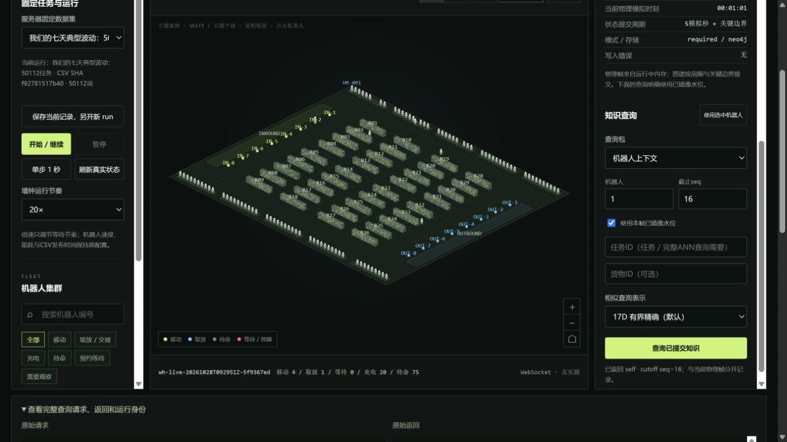

# 实时界面使用与数据接入

## 1. 现在从哪里打开

Pro6000的新实时入口：**http://127.0.0.1:14186/**。当前本机SSH隧道已经建立；原14183/14184回放及旧实时服务继续保留。

新版保持原三栏控制台、机器人列表和鼠标操作，接入90×76m、36架1728货位、100台机器人的V5真实运行。页面每次收到的是中央协调器的实际内存状态；不在浏览器里生成假任务或推进假机器人。



该图记录了真实操作后的状态：七天输入已运行至61模拟秒后暂停，知识水位16、镜像滞后0；浏览器的self查询返回同run、同截止水位与批次SHA。用户后续操作会继续推进当前运行。

如果本机隧道断开，可以重新执行：

```powershell
ssh -N -p 28941 -L 127.0.0.1:14186:127.0.0.1:14186 wz@58.48.54.157
```

## 2. 第一次建议这样用

1. 打开页面，确认左侧为“我们的七天典型波动：50112任务”。顶部应显示100台、固定任务总数和当前模拟时间。
2. 选择**20×**，点击**开始 / 继续**。机器人按CSV发布时间接任务，空闲机器人可以待命或充电，100台会随负载轮换。
3. 点击**暂停**。当前完整步骤结束并保存后，才返回暂停确认；路线规划繁忙时可能等几秒。
4. 暂停状态下点击**单步1秒**，真实执行一个模拟步骤并提交状态。
5. 在地图或左侧列表选择机器人，右侧查看阶段、电量、任务、货物和实际坐标。
6. 右侧保留默认“机器人上下文”，点击**查询已提交知识**。展开底部详情可以看到完整请求、run编号、截止seq、批次SHA及完整返回。

首次七天输入开始时有864件初始库存；尚未发布的任务会随时间出现。均匀日通常只需一部分机器人工作。想观察密集作业，可以在暂停后选择“高峰：1728任务”，另开新run。

### 鼠标和视图

- 左键拖动：旋转；Shift＋左键或右键拖动：平移。
- 滚轮：以光标位置缩放；右下角按钮可放大、缩小、复位。
- “俯视”查看二维路线关系，“透视”查看货架与机器人。
- 点击机器人或使用左侧搜索/过滤；“需要观察”按实际故障/阻塞及低电状态统计，普通预约等待单列。
- 货架层筛选显示对应层的箱位；机器人仍在二维地面移动，上下架使用明确的取放耗时。

## 3. 三个数据集怎样选择

|数据集|用途|
|---|---|
|快速闭环：19任务|快速看完整入库、出库；250模拟秒对正在载货移动的机器人报告SOC24，观察真实低电接力|
|高峰：1728任务|观察密集任务与100机器人能力，使用该高峰场景声明的充电策略|
|七天典型波动：50112任务|本轮相同CSV与初始库存，连续库存、多种代表性负载|

选择下拉框只是在选择下一次运行的输入。当前运行暂停或完成后，点击**保存当前记录，另开新run**才会真正切换。旧输出、检查点、journal和图谱run都保留；新run使用唯一编号。

固定输入模式关闭原控制台的随机流量、“新增100单”和随机优先任务。数据生成同学调整CSV、初始库存和manifest，再通过服务端注册表加入新别名即可。详细合同见[lys交接说明](LYS_DATASET_HANDOFF.md)。

## 4. 机器人、图谱和查询怎样同时运行

```text
控制按钮 → 单一协调器队列 → 完整仿真step → 实际内存帧 → WebSocket → 页面
                                  │
                                  ├→ 原始journal + checkpoint
                                  └→ Neo4j同批提交 → 已镜像seq → 知识查询
```

页面显示两个时间：

- **当前物理模拟时刻**：机器人实际走到哪一步。
- **图谱已提交模拟时刻**：目前查询能够稳定读取到的知识位置。

实时界面默认每**5模拟秒**提交完整100机器人状态，保留全部业务事件；低电及交接前额外发布一致的关键状态。物理画面可以暂时领先图谱几秒。`durable_seq`与`mirrored_seq`相同、`lag=0`表示图镜像已追上原始提交。

后台百万级实验采用独立run和**120模拟秒**周期，当前界面用独立数据库17690与独立输出，两者互不控制。图谱更新、页面刷新和请求响应耗时分别计量。

右侧“使用本帧已镜像水位”默认开启。普通查询按ID和时间获取精确事实；相似历史选择17D有界精确，旧32D完整ANN可显式选择。地图刷新不会自动触发ANN。历史不足时可能没有相似候选；服务不会复制当前状态来凑数。

独立互动验收已实际完成：required模式19/19任务、1次低电交接、2次历史门禁查询；400批/40,000条真实状态与源一致，12个完整服务返回严格通过来源核验。主页面实际浏览器也完成了单步、运行、暂停及查询。具体范围和DOM数字表示检查见[互动验收报告](evidence/platform-v1/live-interactive-acceptance-report.md)；该小样例与百万级实验分别计量。

`required`模式在实际接力规划与货物交接前读取共享历史并授权。普通只读知识包供查询与观察，返回的`used_by_live_control=false`描述这些包自身；实际授权链由`knowledge_runtime`独立执行。

## 5. 倍速、暂停与保存的含义

1×的目标是1模拟秒对应1墙钟秒；20×、60×调整运行等待节奏。机器人0.8m/s等物理参数、取放耗时、SOC能耗、CSV时间戳都保持不变。实际速度受规划、持久化和图写入耗时限制。

暂停在完整step边界处理，不冻结进程或留下半个货权事务。页面读取与WebSocket连接本身不会推进仿真；断线时只读轮询最新真实帧。暂停后帧龄继续增长是正常现象，模拟时间与seq应保持静止。

源或图谱失败时界面显示错误并保留最后完整帧和持久化检查点，停止自动执行；不会悄悄换成假演示。新run保留旧目录，恢复需匹配原源码、adapter、输入、配置及模式。

## 6. 给开发同学的入口

安装新版实时依赖`requirements-live.txt`，不需要Ray。HTTP测试另用`requirements-live-test.txt`。

```bash
# 本地先用不依赖数据库的真实规则模式
python -m backend.warehouse live --dataset-id sample19 \
  --mode rules --knowledge-backend journal --port 14186

# 先生成自己的七天数据，再选择该已注册别名
python -m backend.warehouse generate --kind multiday --days 7 \
  --seed 20261028 --output data/datasets/live-seven-patterns
```

生产Neo4j连接由环境变量配置，默认`required/neo4j`。`--registry`选择服务端数据别名文件，`--source-root`可显式选择冻结生产源，`--output-root`选择独立运行目录。HTTP只允许注册别名，不能提交任意服务器路径。

主要实现：

- `ops/warehouse_live_runtime.py`：唯一写者、真实step、提交、暂停/恢复及身份。
- `ops/warehouse_live.py`：HTTP、WebSocket、数据别名及按需查询。
- `dist/live.html`、`live.js`、`live-model.mjs`、`live.css`：新版实时界面。
- `backend/warehouse/__main__.py`：`live`统一转发到新进程，明确选择生产源。

Pro6000部署根目录为`/data/workspace/wz/warehouse-live-platform-20261028`，运行在`runs/`，日志在`logs/`；私有Neo4j环境文件不提交Git。原源码冻结实验继续使用其原`source-v2`，新CLI入口与界面adapter单独记录版本。
