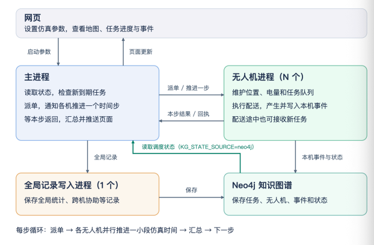

# 仓储项目启动与知识图谱操作手册

本文同时记录共享部署和功能分支的启动方式。`wz/kg-driven-dispatch` 的新路径见第 0.7 节；这里的实现状态不代表共享 4173 已更新部署。当前主路径是 **120×90 medium 布局的 V5 Ray 实时页（4173）**；14185 是多运行回放，14183 是旧 V5 批量帧回放（可选），kg.html 由 4173 直接提供。4173/Ray 的实时运行、14185 的历史回放和 14183 的旧 V5 帧是不同数据源，不能混用 runId。

## 最新运行方式：生产 memory，有界异步完整基准通过，全天待验收

用户最新决定为生产默认 `--kg-state-source memory`；`neo4j` 仅作为可选整场一致性对照，仍同步。生产有界异步写入的核心、小测、真实短测及完整普通/撤销重推基准通过，全天待验收；旧同步 C 套百万资格成绩仍为历史配置，不充当新异步全天或百万资格结果。

对应 Step 仍等 100 台真实落库成功回执，队满时暂停推进、等待写入确认追平后继续，不丢快照、不把入队当完成。CLI 为 `--robot-graph-backlog N`（默认 8，1～128）与 `--robot-graph-sync`（显式同步对照）；不新增校验频率参数。

参数接线已有 16 项小测试通过；有效异步仅在 `memory + --robot-processes ray + --robot-graph + --global-writer-url` 下启用，`neo4j` 始终同步，无服务 URL 的旧用法保留原行为。

真实 24 步短测：100 Ray，Step 0～24 共 25 条、各 100 台完整编号；最大 pending 8，暂停追平 3 次共 11.005 秒，最终 pending 0、清理残留 0。100 actor 上下文 300 次、错误 0，含冷启动均值 393.86ms、P99 955.83ms，不算新百万 C 套资格验收。页缓存调整为 8 GiB 已完成，heap 仍为 4 GiB。

完整普通基准 1780 步、1781 个完整 Step，wall 1066.049 秒、测试总 1076.012 秒；撤销重推 1990 步、1991 个完整 Step，wall 794.894 秒、测试总 805.240 秒。两轮各 Step 均有真实 100 完整编号，final pending 0、max pending 8、cleanup 0，重推 owner=receiver=6。容量追平暂停为 222 次/955.560 秒和 248 次/667.868 秒，是全速容量限流，不是故障计数。普通第 880 步仍观察到 write 83.77 秒，8 GiB 页缓存尚未消除长尾。

调整源于旧全天运行第 9264 步 Step 超时及写入长尾：前 7200 步平均 301ms、P99 1893ms、最大 65906ms，后段最大 24850ms。写入长尾与 Step 超时的具体原因仍待验证。最终整合回归为 127 项：125 通过、1 已知精确错误、1 门控 skip，111.084 秒；最后修改仅为异常清理 run 水位保护和全天最终 Step 审计，派单逻辑未改。新全天尚未完成。用户已授权全部通过后合并、推送并告知 lys，无需再次确认，当前因此未执行。

完整普通/重推的实际速度约 1.67/2.50 倍。后台写入平均/P99/最大分别为 432.387/2985.782/83769.562ms 和 248.603/1137.602/4220.282ms，超过 5 秒次数为 6/0；上下文 17900/20000 次、错误均 0，平均 67.472/66.904ms、P99 273.624/260.440ms、最大 388.398/345.642ms。这不是新百万 C 套资格测量。全天可粗估约 10～15 小时，受写入长尾影响，不承诺固定完成时间；当前尚未完成。

全天运行器自身的 24 步短测也通过：25 个完整 Step，最大落后 8 步，容量暂停 2 次共 5.585 秒，最终 pending/lag/error 为 0、上下文 300 次错误 0、cleanup 0，报告为 `bounded_complete`，不表示全天完成。提交后计划运行 `wz-test-day-memory-async-20261030`，输出 `/tmp/wz-kg-evidence/full-day-memory-async-20261030`，当前仍未完成。
## 0. Ray 目标架构与实现状态

下图是目标架构：主进程只派单/汇总，每个机器人进程维护自身状态并写图谱，另有全局记录进程与 Neo4j。



### 0.1 图中要求

| 模块 | 要求 |
|---|---|
| 网页 | 设置仿真参数，查看地图、任务进度与事件；主进程向页面推送更新。 |
| 主进程 | 读取状态，检查新任务，派单，通知各机器人推进一个时间步，等待本步返回，汇总并推送页面；只负责派单和返回。 |
| 机器人进程（N 个） | 维护位置、电量、任务队列；执行配送并产生/写本机事件；配送途中也可接收新任务。 |
| 全局记录进程（1 个） | 接收主进程的 HTTP 记录，保存全局统计、跨机协助、负责人变更和 Step；调度状态由主进程读取。 |
| Neo4j 知识图谱 | 保存任务、机器人、事件和状态。 |
| 每步循环 | 派单 → 各机器人并行推进一小段仿真时间 → 汇总 → 下一步。 |

### 0.2 功能分支实现状态

以下状态针对 `wz/kg-driven-dispatch`；共享部署是否更新需单独核对。完整证据见 [最终验收报告](docs/KG_FINAL_ACCEPTANCE_20261030.md)。

| 图中的要求 | 实现与边界 | 验证 |
|---|---|---|
| 主进程派单和汇总 | 保留任务、库存、货位、交通预约和标记处理；生产默认使用 actor 返回的内存副本 | 本地三份基准及真实图谱基准分项记录 |
| 100 个有状态机器人 actor | `--robot-processes ray`，持有状态与计划，按主进程指令推进 | 不与仅算运动段的 `--ray` 混用 |
| 每台机器人写自己的图谱 | `--robot-graph`；完整 19 字段与每 4 步历史采样 | memory 有界异步完整普通/重推通过；Step 仍等 100 台真实落库回执，全天待验收 |
| 可选图谱一致性对照 | 显式 `--kg-state-source neo4j`，仍等完整 Step 并读取精确 tick payload | 非生产默认；该模式缺帧/超时仍暂停 |
| 全局记录服务 | `--global-writer-url`，严格有序 HTTP records；Step、交接、统计和负责人变更 | 负责人只由全局服务维护；非保存点 dispatch 为 `{}` |
| 配送途中接新任务 | V5 的 task_chaining，由主进程派单和规划，actor 顺序执行 | actor 不自行挑任务 |
| 100 机器人上下文查询 | C 套五包；结果只观测，不参与派单 | 实际并发与百万规模资格见最终报告 |
| 恢复、旧路径、前端 | 检查点重建 actor；兼容开关；模式、落后步数、错误信息 | 已测和未运行项目分别记录 |

### 0.3 本轮后续验证

真实 C 套联合验收必须同时满足同 run 超过百万节点、100 个独立机器人进程、查询期间持续写入、至少三轮，并逐轮检查平均耗时小于 500ms。全天运行与图谱快照恢复不因短程测试通过而自动完成；未完成状态保留在最终报告。
## 0.4 Ray 必需启动总览（当前 120 布局）

只考虑 `--ray` 路径。服务一共 4 个，其中 **Neo4j 和回放可选**：

| 服务 | 端口 | 是否必需 | 启动脚本 | 说明 |
|---|---|---|---|---|
| Neo4j | Bolt 47687 / HTTP 47474 | 可选 | `ops/start_neo4j.sh` | kg.html 和 `--robot-graph` 需要；只开页面可省 |
| Ray head | 26380 | 必需 | `ops/start_ray.sh` | 4173 的 100 个 actor；不启动则 `--ray` 无法连接 |
| 主进程 4173 | 4173 | 必需 | `ops/start_runtime.sh --restart --ray [--robot-graph]` | 120×90 medium V5 实时页 |
| 回放 14185 | 14185 | 可选 | `ops/start_replay.sh` | 多运行只读回放；`start_runtime.sh` 也会顺带启动 |

启动顺序：

```bash
cd /home/lys/workspace/projects/warehouse-dashboard

# 可选：图谱/机器人写图谱才需要
bash ops/start_neo4j.sh
export WAREHOUSE_NEO4J_URI='bolt://127.0.0.1:47687'
export WAREHOUSE_NEO4J_USER='neo4j'
export WAREHOUSE_NEO4J_PASSWORD='<你的 Neo4j 密码>'
export WAREHOUSE_NEO4J_DATABASE='neo4j'

# 必需：Ray head
bash ops/start_ray.sh

# 必需：4173 主进程（默认同时启动 14185 回放）
# 需要全局记录 writer 时加 --global-writer
bash ops/start_runtime.sh --restart --ray --robot-graph --global-writer

# 可选：如果上面的脚本没有启动回放，再单独启动
bash ops/start_replay.sh
```

说明：

- `start_runtime.sh` 的 medium 分支**不会自动启动 Neo4j/Ray**；必须先用上面两个脚本或手工命令启动。
- `--robot-graph` 需要 `WAREHOUSE_NEO4J_PASSWORD`；不启用图谱写入时去掉该参数。
- 100 个 Ray actor 由主进程自动创建，不需要手工启动；当前配置为 100 × 0.1 CPU = 10 CPU。
- `--global-writer` 另起一个普通子进程（不是 Ray actor，不占端口），写全局 `RunStat`/全局事件；它不是第 5 个服务，但会显示在 `/api/snapshot` 的 `runtime.workerProcessCount/globalWriter`。
- 回放和 Neo4j 都可以不启动：不启动回放则没有 14185；不启动 Neo4j 则 kg.html 查询和机器人写图谱不可用，但 120 页面本身仍可运行。
- 不要执行 `ray stop` / `ray stop --force`；它会停掉本机所有 Ray head，包括其他协作者共用的 26380。

## 0.5 前端布局协作者：独立 Ray 测试

前端布局协作者可以自行启动一套独立 Ray + 120 页面做联调，但**不要占用共享的 26380 / 4173 / 14185 / 47687**。建议端口：

| 用途 | 建议端口 |
|---|---|
| 独立 Ray head | `27380` |
| Ray worker | `27400–27599` |
| Ray dashboard | `19265`（可选） |
| Ray client server | `21001`（可选） |
| 独立 120 页面 | `14590` |

```bash
cd /home/lys/workspace/projects/warehouse-dashboard

# 1. 独立 Ray head（不要复用 26380）
./.venv/bin/ray start --head \
  --node-ip-address=127.0.0.1 --port=27380 --num-cpus=4 \
  --temp-dir=/tmp/wh-ray-frontend \
  --min-worker-port=27400 --max-worker-port=27599 \
  --dashboard-port=19265 --ray-client-server-port=21001 \
  --disable-usage-stats

# 2. 独立 120 页面；100 actor × 0.02 CPU = 2 CPU
RAY_ADDRESS=127.0.0.1:27380 ./.venv/bin/python -m backend.warehouse live \
  --source-root . --dist dist \
  --registry config/live-wheeled-datasets.json \
  --dataset-id medium19 --output-root /tmp/wh-frontend-runs \
  --mode rules --knowledge-backend journal --mobility wheeled \
  --ray --ray-address 127.0.0.1:27380 --ray-actor-cpus 0.02 \
  --commit-seconds 5 --port 14590

# 3. 浏览器打开 http://127.0.0.1:14590/，或调用：
curl -s --noproxy '*' -X POST -H 'Content-Type: application/json' \
  -d '{"action":"start"}' http://127.0.0.1:14590/api/control
```

约定：

- 默认不启用 `--robot-graph`，因此不写共享 Neo4j；需要图谱时请使用自己的 Neo4j/数据库，不要写共享 47687。
- 不要重启或停止共享 4173、14185、26380；只操作自己的 14590/27380，且不要全局 `ray stop`。
- 如果改的是前端布局，把自己的 `--dist` 指向自己的构建目录；数据集先用 `medium19`，需要完整峰值再用 `medium1728`。
- 上面的 4 CPU 是布局联调示例。wz 已确认本任务的独立 Ray 可按需使用全部 CPU；性能对照分别记录 4、16、32 CPU。Ray 配额不是 OS 核绑定。
- 停止时只停 14590 的 live 进程；**不要执行 `ray stop` 或 `ray stop --force`**，`ray stop` 会停止本机所有 Ray head，包括共享的 26380。独立 head 可以保留给下次联调；确实要清理时，先用 `ss -ltnp | grep 27380` 找到自己的 `gcs_server` 进程，只处理该 head 的进程，不要做全局 stop。

## 0.6 当前协作分工

| 范围 | 负责方 | 实现 |
|---|---|---|
| 主进程派单、路线、库存、交通、标记与汇总 | wz | 全局状态保留在主进程 |
| 有状态 RobotActor 与本机读写 | wz | `backend/robot_actor/`；复用 lys 的图谱 writer/query |
| 全局 HTTP 写入服务、C 套结构及查询基础 | lys | 主进程通过 HTTP 提交，服务写 Step、统计、交接和唯一负责人 |
| 页面与压测 | wz | 页面状态字段、C 套真实并发验收 |

`--ray` 的 MotionActor 和本地版保留为对照。目标路径使用 `--robot-processes ray`，不是同时使用两类 Ray 执行器。旧 A 套快照与 AgentFleet 的兼容/弃用状态见第 0.7 节及最终报告。

## 0.7 有状态机器人与图谱驱动派单

以下命令把派单来源显式设为 memory，并满足有界异步生效条件；新全天结果仍单独验收。先准备可用的 Neo4j 与独立 Ray，再启动全局服务，最后启动实时服务。Neo4j 密码从已有环境文件加载，不写入命令历史。

```bash
cd /data/workspace/wz/warehouse-integration-on-lys
export LADE_ENV_DIR=/data/workspace/wz/warehouse-deploy/.venv
export PYTHONPATH=/data/workspace/wz/testdeps-httpx2:$PWD
export RAY_AUTH_MODE=disabled
set -a
source /data/workspace/wz/warehouse-wheel-agents-20261029/graph-test/neo4j.env
set +a
export NEO4J_URI=bolt://127.0.0.1:17692
export WAREHOUSE_NEO4J_URI=$NEO4J_URI
export WAREHOUSE_NEO4J_USER=${NEO4J_USER:-neo4j}
export WAREHOUSE_NEO4J_PASSWORD=${NEO4J_PASSWORD:-$WAREHOUSE_NEO4J_PASSWORD}

# 终端一：全局记录服务
bash run_in_lade.sh python -m backend.global_writer_api --port 14591

# 终端二：有状态 Ray actor 的实时主进程
bash run_in_lade.sh python -m backend.warehouse live \
  --source-root . --dist dist --registry config/live-wheeled-datasets.json \
  --dataset-id medium19 --output-root /tmp/wh-kg-live-runs \
  --mode rules --knowledge-backend journal --mobility wheeled \
  --robot-processes ray --ray-address 127.0.0.1:27380 --ray-actor-cpus 0.02 \
  --robot-graph --global-writer-url http://127.0.0.1:14591 \
  --kg-state-source memory --robot-context-interval 10 \
  --commit-seconds 5 --port 14590
```

| 选项 | 含义 |
|---|---|
| `--robot-processes off/local/ray` | 原顺序、本地拆分、有状态 Ray 拆分；`ray` 与旧 `--ray` 互斥 |
| `--robot-graph` | 每个 actor 通过 lys writer 写自己的 C 套子图与完整状态 |
| `--global-writer-url URL` | 主进程向全局 HTTP 服务按步提交记录；不与旧 `--global-writer` 混用 |
| `--kg-state-source memory/neo4j` | 生产默认 `memory`；`neo4j` 为可选整场同步一致性对照，仍要求 Ray、robot-graph 和服务 URL |
| `--robot-graph-backlog N` | 有界异步队列上限，默认 8，1～128 |
| `--robot-graph-sync` | 显式同步对照；neo4j 模式本身仍同步 |
| `--robot-context-interval N` | 每 N 步，100 个 actor 并发取回 C 套五包；默认 10，0 关闭；只记录耗时与条数 |
| `--legacy-a-graph` | 显式兼容旧 A 套镜像，默认关闭；本地 journal 与页面保留 |
| `--robot-agents` | 已弃用的 AgentFleet 路径，不作为新运行入口 |

生产默认从 actor 返回的内存副本派单。可选 neo4j 一致性对照只读机器人状态；`--knowledge-backend journal` 保留本地提交/恢复，不改变这项派单选择。C 套由 actor 和 HTTP 全局服务写入。旧 `--ray` MotionActor 与 local 模式作为对照保留。原始指标的旧同步 KG 结果保留在验收报告中；新有界异步路径需另行验证，不能沿用旧通过结论。

`--mode` 默认使用 `rules`。显式使用旧 A 套历史决策的 `--mode required` 时，必须同时给 `--legacy-a-graph`；默认也不启动旧 A 套 QueryCatalog。页面的实际 snapshot 和 C 套图谱 API 保留。

### 分层测试

```bash
# 开发中：快速检查（约 6 秒）
bash ops/kg_dev_env.sh python -m unittest tests.test_robot_process_quick

# 单项完成：相关接口、恢复和状态边界；按改动选择
bash ops/kg_dev_env.sh python -m unittest \
  tests.test_kg_state tests.test_robot_process_wiring tests.test_global_record_client \
  tests.test_robot_context tests.test_robot_recovery tests.test_legacy_graph_switch

# 最后集中检查派单和相关模块
bash ops/kg_dev_env.sh python -m unittest \
  tests.test_robot_process_split tests.test_dispatch_golden \
  tests.test_warehouse_live_runtime tests.test_global_writer

# 有真实 Ray、全局服务与 Neo4j 才运行三份图谱基准
WAREHOUSE_KG_RESULT_DIR=/tmp/wz-kg-evidence bash ops/kg_dev_env.sh \
  python -m unittest -fv tests.test_robot_process_kg

# 实时 HTTP 与同一边界的 memory 检查点对照，脚本自动用 wz-test- ID
bash ops/kg_dev_env.sh python ops/kg_live_check.py \
  --ticks 400 --output /tmp/wz-kg-evidence/live

# 相同窗口的五阶段计时（先用 kg_ray_cluster.py --cpus 4/16/32 分别启动）
bash ops/kg_dev_env.sh python ops/kg_probe.py \
  --scenario ordinary --ticks 100 --output /tmp/wz-kg-evidence/active-cpu32.json
```

`tests.test_warehouse_runtime_graph` 已知有一项旧测试因固定调用下标导致 `KeyError: 'robots'`，其他项仍需通过。真实集成测试用环境变量控制，未启用时的 skip 不计为真实验收通过。实时脚本跑到指定边界后暂停；400 步对照不能代替全程完成或全天稳定性结论。

### C 套联合验收与全天运行

```bash
# 真实查询来自 RobotContextClient，与机器人 actor 使用相同查询实现
bash ops/kg_dev_env.sh python -m ops.joint_acceptance \
  --run-id wz-test-joint-c-20261030 --prefix-nodes 1000000 \
  --clients 100 --rounds 3 --duration 2 --output /tmp/wz-kg-evidence/joint-c

# 准备覆盖完整 24 小时的任务分布；实际运行另起独立实验
bash ops/kg_dev_env.sh python ops/kg_long_run.py prepare \
  --scene data/layouts/expansion-candidates/medium/layout.json \
  --output /tmp/wz-kg-evidence/full-day-dataset
bash ops/kg_dev_env.sh python ops/kg_long_run.py run \
  --scene data/layouts/expansion-candidates/medium/layout.json \
  --dataset /tmp/wz-kg-evidence/full-day-dataset \
  --output /tmp/wz-kg-evidence/full-day-run --run-id wz-test-full-day-20261030 \
  --robot-context-interval 10 --cleanup
```

联合验收以每轮平均耗时 `<500ms` 判定；同时报告同 run 节点数、100 个独立进程、写入重叠、P99、最大值和超限次数。三轮中任一轮不具备实际并发或写入条件，都不能算通过。全天运行按 7200 秒窗口记录推进、写入、等待 Step、读取、派单和上下文耗时；用 `--max-ticks N` 跑短程时，报告必须标注未完成全天。

## 1. 当前版本包含的功能

|功能|入口|说明|
|---|---|---|
|当前 120 布局|`data/layouts/expansion-candidates/medium/layout.json`|120×90 米、48 货架、2304 货位、100 泊位；当前主页面布局。|
|基础仓库模型|`data/layouts/warehouse100-wide-v2.json`|90×76 米、36 货架、1728 货位；保留为旧实验基线。|
|协作者扩展布局|`data/layouts/expansion-candidates/balanced/layout.json`|100×90 米、40 货架、1920 货位；旧扩展候选。|
|测试数据生成|`scripts/generate_warehouse100_dataset.py`|生成任务、初始库存和 manifest 数据包。|
|静态图谱导入|`scripts/import_warehouse_neo4j.py`|写入仓库、货架、货位、货物与任务。|
|V5 调度|`python -m backend.warehouse run/live`|100 机器人派单、路径、取放、充电、库存与运行帧。|
|4173 medium Ray 实时页|`python -m backend.warehouse live --ray`|V5 中央协调 + 100 个 Ray actor；当前主入口。|
|V5 旧单 run 回放|`python -m backend.warehouse serve`，14183|读取某次 V5 输出目录中的真实帧，可选。|
|知识图谱工作台|`http://127.0.0.1:4173/kg.html`|只读查询 Neo4j 中的静态和运行态图谱。|
|运行态图谱写入|V5 `run` 或 4173 `--robot-graph`|写入 `Run`、`Robot`、`AgentState`、`Execution`、`RuntimeEvent`。4173 由每个 Ray actor 写自己的子图。|
|百万级图谱数据|`scripts/generate_million_runtime_dataset.py`|生成 100×10000 条 `AgentState` 用于规模实验。|

### 页面、数据与端口

|页面/服务|地址|数据来源|是否写 Neo4j|
|---|---|---|---|
|4173 主页面|`http://127.0.0.1:4173/`|120×90 medium、48 架、2304 货位；V5 中央调度 + Ray actor|启用 `--robot-graph` 时每个 actor 写自身 Robot/AgentState/Event。|
|4173 图谱工作台|`http://127.0.0.1:4173/kg.html`|项目专用 Neo4j|否，仅查询。|
|14185 多运行回放|`http://127.0.0.1:14185/wide.html`|`data/local-runs` / `data/runs` 的 `frames.sqlite`|否，只读回放。|
|14183 旧 V5 帧回放|`http://127.0.0.1:14183/`|某次 V5 批量 `run` 的 `frames.sqlite`|否，仅读取帧；可选。|
|Ray head|`127.0.0.1:26380`|100 个 actor 的调度面|不适用。|
|Neo4j Browser|`http://127.0.0.1:47474`|项目专用 Neo4j|数据库本身；可选。|
|Neo4j Bolt|`bolt://127.0.0.1:47687`|Python 与 Neo4j 通信|数据库本身；可选。|

> 4173 主页面是 120 medium 的 Ray 实时页；14185 回放的是已落盘的 `frames.sqlite`，两者不是同一运行数据源，不能混用 runId。14183 只作为旧 V5 批量帧回放保留。

## 2. 首次准备 Python 与 Java 21

从项目根目录执行，不需要 `sudo` 或 LaDe 环境：

```bash
cd /home/lys/workspace/projects/warehouse-dashboard

if [ ! -x .venv/bin/python ]; then python3 -m venv .venv; fi
if ! ./.venv/bin/python -m pip --version >/dev/null 2>&1; then
  ./.venv/bin/python -m ensurepip --upgrade
fi

./.venv/bin/python -m pip install --upgrade pip
./.venv/bin/python -m pip install -r requirements.txt -r requirements-platform.txt
./.venv/bin/python -m pip install --force-reinstall 'jdk4py==21.0.8.2'

export JAVA_HOME="$(./.venv/bin/python -c 'from jdk4py import JAVA_HOME; print(JAVA_HOME)')"
"$JAVA_HOME/bin/java" -version
```

最后一条应显示 Java 21。

## 3. 项目专用 Neo4j（可选）

项目的 Neo4j 数据目录为 `.runtime/warehouse-neo4j-5.26.32/`，端口固定为 HTTP `47474`、Bolt `47687`，不会占用其他项目默认的 `7474/7687`。

如果目录不存在，首次安装：

```bash
NEO4J_VERSION='5.26.32'
WAREHOUSE_NEO4J_HOME="$PWD/.runtime/warehouse-neo4j-$NEO4J_VERSION"
mkdir -p .runtime
curl -fL --retry 3 -o ".runtime/neo4j-$NEO4J_VERSION.tar.gz" \
  "https://dist.neo4j.org/neo4j-community-$NEO4J_VERSION-unix.tar.gz"
tar -xzf ".runtime/neo4j-$NEO4J_VERSION.tar.gz" -C .runtime
mv ".runtime/neo4j-community-$NEO4J_VERSION" "$WAREHOUSE_NEO4J_HOME"
```

首次配置仅针对本项目实例执行：

```bash
WAREHOUSE_NEO4J_CONFIG="$WAREHOUSE_NEO4J_HOME/conf/neo4j.conf"
sed -i -e '/^server\.default_listen_address=/d' -e '/^server\.bolt\.enabled=/d' \
  -e '/^server\.bolt\.listen_address=/d' -e '/^server\.http\.enabled=/d' \
  -e '/^server\.http\.listen_address=/d' -e '/^server\.https\.enabled=/d' \
  "$WAREHOUSE_NEO4J_CONFIG"
printf '\nserver.default_listen_address=127.0.0.1\nserver.bolt.enabled=true\nserver.bolt.listen_address=:47687\nserver.http.enabled=true\nserver.http.listen_address=:47474\nserver.https.enabled=false\n' >> "$WAREHOUSE_NEO4J_CONFIG"

export JAVA_HOME="$(./.venv/bin/python -c 'from jdk4py import JAVA_HOME; print(JAVA_HOME)')"
"$WAREHOUSE_NEO4J_HOME/bin/neo4j-admin" server validate-config
"$WAREHOUSE_NEO4J_HOME/bin/neo4j-admin" dbms set-initial-password 'test123456'
```

`set-initial-password` 只能在空库首次执行。日常启动及验证：

```bash
export WAREHOUSE_NEO4J_HOME="$PWD/.runtime/warehouse-neo4j-5.26.32"
export JAVA_HOME="$(./.venv/bin/python -c 'from jdk4py import JAVA_HOME; print(JAVA_HOME)')"
"$WAREHOUSE_NEO4J_HOME/bin/neo4j" start
"$WAREHOUSE_NEO4J_HOME/bin/neo4j" status
"$WAREHOUSE_NEO4J_HOME/bin/cypher-shell" \
  -a 'bolt://127.0.0.1:47687' -u neo4j -p 'test123456' 'RETURN 1 AS connected;'
```

## 4. 最短完整闭环

> 4.1 是已归档的旧 1728 对照；4.2、4.4、5 已改为 medium 批量/回放。当前 Ray 必需启动只用第 0 节 + 4.3；120 布局数据已存在，不需要重新生成 1728 数据。

### 4.1 旧 1728 布局实验（不是当前 120 布局）

这一节是**旧基线**，不是当前 4173 的 120 medium 布局：

| 项目 | 4.1 旧 1728 | 当前 4173 medium |
|---|---|---|
| 布局 | `warehouse100-wide-v2`：90×76m、36 架、1728 货位 | `medium`：120×90m、48 架、2304 货位 |
| 数据 | `data/generated/warehouse100-day1`（已删除） | `data/examples/wheeled-medium-peak` / `sample19` |
| 配置 | 旧 V5/legacy 默认 | `config/wheeled-medium-100.json` |
| 用途 | 旧实验基线、legacy 对照 | 当前 Ray 实时页 |

旧 1728 数据包**不能**直接给当前 120 页面使用：货位数、任务位置和布局不同。当前 4173 不需要重新生成 1728 数据。

旧 1728 数据已从当前 Neo4j 静态图谱删除，后续不再以它作为默认数据源；如需复现历史实验，请从 Git 历史恢复对应脚本/数据，不要重新导入为当前基准。

**当前 120 布局的静态图谱**使用 medium 的同一套 layout/locations：

```bash
export WAREHOUSE_NEO4J_URI='bolt://127.0.0.1:47687'
export WAREHOUSE_NEO4J_USER='neo4j'
export WAREHOUSE_NEO4J_PASSWORD='test123456'
export WAREHOUSE_NEO4J_DATABASE='neo4j'

./.venv/bin/python scripts/import_warehouse_neo4j.py \
  --package-dir data/examples/wheeled-medium-peak \
  --layout data/layouts/expansion-candidates/medium/layout.json \
  --locations data/layouts/expansion-candidates/medium/task-locations.csv \
  --apply
```

> 当前 Neo4j 静态图谱已切换为 medium：`Dataset=dataset:warehouse-logical-boundaries-v1:2026-10-27`（capacity 2304），`Warehouse=warehouse:warehouse100-expanded-medium-v1`，48 架/2322 货位/4 zone。旧 1728 Dataset、任务、货物和 Warehouse 已从静态图谱删除。
>
> 运行期 `Run.dataset_id` 现在写 canonical medium Dataset id，`Run-[:USES_DATASET]->Dataset` 已能建立。历史 1728 run 节点/AgentState 仍可能留在 Neo4j 作为历史记录，但它们不再属于当前静态基准；如需彻底清理需单独做批量维护。

静态图谱包含 `Warehouse`、`Zone`、`Rack`、`Location`、`Dataset`、`Goods`、`WarehouseTask`，以及 `FROM`、`TO`、`CONCERNS` 关系。

### 4.1.1 旧 1920 / 32×22 布局（已归档）

旧 balanced 1920、console 32×22 和 1728 数据包已不再作为当前基准；本节不再提供导入/生成命令。若需要复现历史实验，请从 Git 历史恢复对应提交，不要写回当前 medium Dataset。

### 4.2 medium 批量运行并写回放帧

当前 120 布局的短跑示例：

```bash
export WAREHOUSE_NEO4J_URI='bolt://127.0.0.1:47687'
export WAREHOUSE_NEO4J_USER='neo4j'
export WAREHOUSE_NEO4J_PASSWORD='<你的 Neo4j 密码>'
export WAREHOUSE_NEO4J_DATABASE='neo4j'

RUN_ID="medium-v5-$(date +%Y%m%d-%H%M%S)"
RUN_DIR="data/local-runs/$RUN_ID"

./.venv/bin/python -m backend.warehouse run \
  --scene data/layouts/expansion-candidates/medium/layout.json \
  --dataset data/examples/wheeled-medium-sample19 \
  --config-json config/wheeled-medium-100.json \
  --output "$RUN_DIR" --run-id "$RUN_ID" \
  --mode rules --knowledge-backend journal --mobility wheeled \
  --until 600 --window --frames --max-wall-seconds 180

ls "$RUN_DIR/latest.json" "$RUN_DIR/frames.sqlite" "$RUN_DIR/checkpoint.json"
```

此命令生成 120 medium 布局的 100 机器人状态和回放帧；`--until 600` 是 10 模拟分钟，任务较少是正常现象。

### 4.3 启动 4173 medium Ray 与机器人图谱写入

先启动 Ray head；Neo4j 只有 kg.html 或 `--robot-graph` 需要：

```bash
cd /home/lys/workspace/projects/warehouse-dashboard

# 可选：图谱和机器人写图谱
bash ops/start_neo4j.sh
export WAREHOUSE_NEO4J_URI='bolt://127.0.0.1:47687'
export WAREHOUSE_NEO4J_USER='neo4j'
export WAREHOUSE_NEO4J_PASSWORD='<你的 Neo4j 密码>'
export WAREHOUSE_NEO4J_DATABASE='neo4j'

# 必需：Ray head
bash ops/start_ray.sh
```

再启动 4173 主进程（`start_runtime.sh` 会顺带启动 14185 回放；不需要回放可单独用 `start_medium.sh`）：

```bash
bash ops/start_runtime.sh --restart --ray --robot-graph --global-writer
```

或者完全不用脚本，直接启动：

```bash
RAY_ADDRESS=127.0.0.1:26380 \
WAREHOUSE_NEO4J_URI='bolt://127.0.0.1:47687' \
WAREHOUSE_NEO4J_USER='neo4j' \
WAREHOUSE_NEO4J_PASSWORD='<你的 Neo4j 密码>' \
WAREHOUSE_NEO4J_DATABASE='neo4j' \
./.venv/bin/python -m backend.warehouse live \
  --source-root . --dist dist \
  --registry config/live-wheeled-datasets.json \
  --dataset-id medium1728 --output-root data/local-runs \
  --mode rules --knowledge-backend journal --mobility wheeled \
  --ray --ray-address 127.0.0.1:26380 --ray-actor-cpus 0.1 \
  --robot-graph --graph-state-interval 4 \
  --global-writer --global-writer-queue 256 \
  --commit-seconds 5 --max-active-robots 100 --port 4173
```

打开 `http://127.0.0.1:4173/`，右上角「知识图谱工作台」进入 `kg.html`；填入 `/api/health` 返回的 `runId`。当前 health/snapshot 应显示：

```text
backend=warehouse-real-scale-v1-ray
rayActorCount=100
robotGraphWriter=ray-actors
robotGraphErrors=0
runtime.workerProcessCount=2          # 主进程 + global writer child
runtime.globalWriter.processAlive=true
runtime.globalWriter.errors=0
runtime.globalWriter.dropped=0
```

全局记录可通过以下只读接口查询：

```text
/api/kg/warehouse/runs/{runId}/stats
/api/kg/warehouse/runs/{runId}/global-events
/api/kg/warehouse/runs/{runId}/assists
/api/kg/warehouse/runs/{runId}/dispatch
```

注意：`start_runtime.sh` 的 medium 分支**不会自动启动 Neo4j/Ray**；必须先执行上面的 `start_neo4j.sh`（可选）和 `start_ray.sh`。

### 4.3.1 4173 medium Ray 的回放从哪来

当前 medium live **不写 `frames.sqlite`**，所以 4173 的实时运行不会自动出现在 14185。要在 14185 回放 120 布局，需要单独跑一条带 `--frames` 的批量记录：

```bash
./.venv/bin/python -m backend.warehouse run \
  --scene data/layouts/expansion-candidates/medium/layout.json \
  --dataset data/examples/wheeled-medium-sample19 \
  --config-json config/wheeled-medium-100.json \
  --output data/local-runs/medium-replay-1800 \
  --run-id medium-replay-1800 \
  --mode rules --knowledge-backend journal --mobility wheeled \
  --until 1800 --window --frames --max-wall-seconds 240
```

然后 14185 会扫描到该 run，打开 `http://127.0.0.1:14185/` 选择它。4173 实时页和这条批量回放是不同 runId，但布局都是 120×90/48 架/2304 货位。

### 4.4 单 run 帧回放（可选，14183）

另开终端时，变量不会保留。先设置最近一次 medium 批量运行目录：

```bash
export RUN_DIR="$(ls -td data/local-runs/medium-v5-* | head -1)"
```

然后启动回放：

```bash
./.venv/bin/python -m backend.warehouse serve --output "$RUN_DIR" --port 14183
```

打开 `http://127.0.0.1:14183/`。该页面是第 4.2 节生成的 120 布局真实运行帧回放。

### 4.5 多运行回放服务（固定端口 14185）

`backend.replay_service` 是独立的只读回放服务，扫描 `data/local-runs` 和 `data/runs`，在页面右上角选择已有 run 回放。它是**可选服务**，推荐用脚本启动：

```bash
bash ops/start_replay.sh
# 等价于：
LADE_ENV_DIR="$PWD/.venv" ./run_in_lade.sh python -m backend.replay_service
```

默认监听 `127.0.0.1:14185`，自动扫描 `data/local-runs` 与 `data/runs`，不需要指定 run 参数。打开 `http://127.0.0.1:14185/wide.html`：

- 有正在写入的批量 run 时会标记为“● 当前”；没有时默认选择最近的历史 run。
- 4173 medium live 不写 `frames.sqlite`，所以实时 run 不会出现在这里；需要回放时用 4.3.1 的批量 `--frames` 记录。
- 右上角“运行”下拉框可手动切换任意历史 run。
- 可选 `--port` 改端口；可选 `--runs-root <目录>` 重复添加扫描目录。
- 可选 `--neo4j`，启用页面下方的只读知识查询；不启用时回放本身仍可用。
- 4173 右上角“回放页面”默认指向 14185；也可用 `http://127.0.0.1:4173/?replayPort=14185` 覆盖端口。
- 服务只读，不推进仿真、不写 checkpoint 或图谱；一个服务可浏览多个 run，但同一时刻只播放选中的 run。

## 5. 完整 medium 仿真

需要观察更多搬运过程时，使用新输出目录，不带 `--until` 与 `--window`：

```bash
export WAREHOUSE_NEO4J_URI='bolt://127.0.0.1:47687'
export WAREHOUSE_NEO4J_USER='neo4j'
export WAREHOUSE_NEO4J_PASSWORD='test123456'
export WAREHOUSE_NEO4J_DATABASE='neo4j'
export WAREHOUSE_NEO4J_PACKAGE_DIR='data/examples/wheeled-medium-peak'

RUN_ID="medium-full-v5-$(date +%Y%m%d-%H%M%S)"
RUN_DIR="data/local-runs/$RUN_ID"

./.venv/bin/python -m backend.warehouse run \
  --scene data/layouts/expansion-candidates/medium/layout.json \
  --dataset data/examples/wheeled-medium-peak \
  --config-json config/wheeled-medium-100.json \
  --output "$RUN_DIR" --run-id "$RUN_ID" \
  --mode rules --knowledge-backend journal --mobility wheeled \
  --frames --max-wall-seconds 1800
```

结束后检查结果并启动回放：

```bash
./.venv/bin/python -c "import json; p=json.load(open('$RUN_DIR/results.json')); print({k:p.get(k) for k in ('status','elapsed','tasks_total','released','unfinished','task_statuses')})"
./.venv/bin/python -m backend.warehouse serve --output "$RUN_DIR" --port 14183
```

在 4173 图谱工作台输入同一个 `$RUN_ID`，即可查询同一次运行的任务与机器人关系。

## 6. 当前 4173 / 14185 / 14183 的分工

`http://127.0.0.1:4173/` 是当前 120×90 medium 的 V5 Ray 实时页，不是 legacy `backend.server` 的 32×22 控制台：

- **4173 根页面**：V5 中央协调器派单/交通/库存/换电，100 个 Ray actor 执行每机器人运动段；启用 `--robot-graph` 时每个 actor 写自己的 Robot/AgentState/Event。
- **4173/kg.html**：查询 Neo4j 的静态图谱和运行态追溯。
- **14185**：多运行只读回放，扫描已落盘的 `frames.sqlite`；medium live 本身不录制帧。
- **14183**：旧 V5 批量帧回放，可选，不作为 Ray 必需服务。

4173 实时页与 14185 回放使用不同 runId；需要回放 120 布局时，用 4.3.1 的批量 `--frames` 记录。

## 7. 百万级运行态图谱数据（可选）

该步骤生成 100×10000=1,000,000 条 `AgentState`，用于规模数据和查询实验，不替代 V5 搬货仿真：

```bash
./.venv/bin/python scripts/generate_million_runtime_dataset.py
./.venv/bin/python scripts/generate_million_runtime_dataset.py --write
./.venv/bin/python scripts/import_runtime_replay_neo4j.py \
  --dir data/generated/million-runtime-replay --apply
```

执行前确认 `WAREHOUSE_NEO4J_*` 仍指向本项目 Neo4j，且有足够磁盘空间。

## 8. 常见问题

|现象|处理方式|
|---|---|
|`serve needs recorded frames/latest/checkpoint`|`--output` 指向错误，或 `run` 没有带 `--frames`；检查三个文件。|
|新终端中 `$RUN_DIR` 为空|变量不会跨终端保留；重新 `export RUN_DIR=...`。|
|Neo4j 认证失败|确认 Bolt 为 47687、用户名 `neo4j`、密码 `test123456`。|
|`Server responded HTTP`|把 HTTP 47474 错用于 Bolt 客户端；应使用 47687。|
|图谱工作台没有运行态|4173 需带 `--robot-graph` 和 `WAREHOUSE_NEO4J_PASSWORD`；并输入当前 `/api/health` 的 `runId`。|
|4173 启动报 Ray 连接失败|先执行 `bash ops/start_ray.sh`，或用 `--ray-address 127.0.0.1:26380` 指向已有 head。|
|4173 与 14185 机器人不同|正常：4173 是实时 V5 Ray，14185 是已落盘的批量帧。|
|只想开 120 页面，不想装 Neo4j|去掉 `--robot-graph`、不启动 `start_neo4j.sh`；kg.html 查询不可用。|

## 9. 停止服务

前台运行的 4173、14183 或 Neo4j `console` 使用 `Ctrl+C`。

后台服务按需停止：

```bash
# 4173 主进程
[ -f .runtime/pids/4173.pid ] && kill "$(cat .runtime/pids/4173.pid)" || true

# 14185 回放（可选）
[ -f .runtime/pids/replay.pid ] && kill "$(cat .runtime/pids/replay.pid)" || true

# Neo4j（可选）
export WAREHOUSE_NEO4J_HOME="$PWD/.runtime/warehouse-neo4j-5.26.32"
"$WAREHOUSE_NEO4J_HOME/bin/neo4j" stop

# Ray：不要直接执行 ray stop / ray stop --force；它会停止本机所有 Ray head。
# 共享 26380 由当前 4173 使用；独立 head 请先确认 PID/端口后只清理自己的进程。
```

## 10. 当前边界与后续衔接

当前功能分支保留有状态机器人、C 套完整状态写入、全局 HTTP 记录和可选同步 Neo4j 对照；生产默认 memory，有界异步完整普通/重推通过，全天待验收。共享 4173 与 14185 的部署及历史数据源保持独立。

恢复从本地检查点重建 actor；是否需要从图谱快照恢复，仍由 wz 与 lys 确认。全天数据与按 2 小时分段统计需要真实长时间运行后才能评价是否变慢。C 套联合验收只使用机器人实际执行的查询，不能引用旧 A 套或研究原型成绩替代。

分项结果、修改过的 lys 文件、已通过测试和未运行验收项见 [最终验收报告](docs/KG_FINAL_ACCEPTANCE_20261030.md)。
